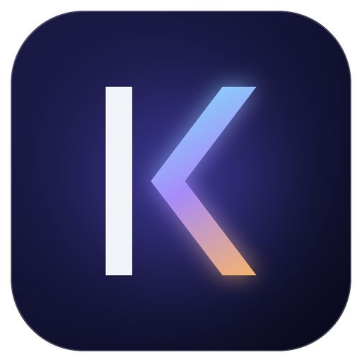

<h1 align="center">Kaivon Code</h1>

A code editor from <a href="https://kaivon.app">Kaivon</a>.

Kaivon Code is built on Code - OSS, the open-source core of VS Code, so it has the editor, terminal, debugger and Git you already know. Extensions come from [Open VSX](https://open-vsx.org).

[Chip](chip) is built in: your coding partner, which reads your project, makes changes you approve, and runs your tests.

It's early. Builds aren't signed yet, so your system will warn you the first time you open one.

## How this repo works

The repo holds what makes Kaivon Code different, not a copy of VS Code. Each build fetches the VS Code version pinned in [`upstream/stable.json`](upstream/stable.json) and applies:

| | |
|---|---|
| [`patches/`](patches) | changes to VS Code's source: no telemetry, Open VSX, no Copilot, and more |
| [`prepare_vscode.sh`](prepare_vscode.sh) | the product's name and identity |
| [`kaivon/apply.mjs`](kaivon/apply.mjs) | the themes and default settings |
| [`src/stable/`](src/stable) | files copied over VS Code's: icons, the Kaivon Night and Day themes |
| [`chip/`](chip) | the Chip extension, which also works in any VS Code |
| [`icons/make_icons.py`](icons/make_icons.py) | draws every icon from the Kaivon mark |

Pushing a `v*` tag makes [GitHub Actions](.github/workflows/build.yml) build Mac, Windows and Linux and publish them as a release.

## Credits

The build scripts and patches come from [VSCodium](https://github.com/VSCodium/vscodium) (MIT), which does the hard work of building VS Code's source without Microsoft's product layer. `.vscodium-base` records the commit this repo started from. VS Code's source is © Microsoft, under the MIT licence.

Kaivon Code isn't made by or affiliated with Microsoft or the VSCodium project.

## Licence

[MIT](LICENSE). The Kaivon name and logo aren't covered by this licence.
